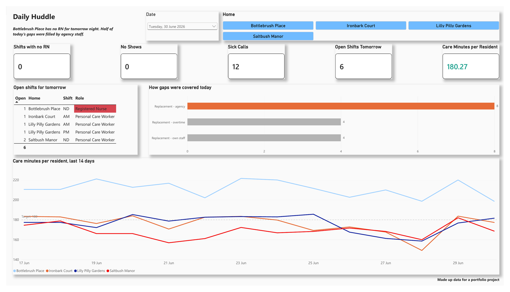
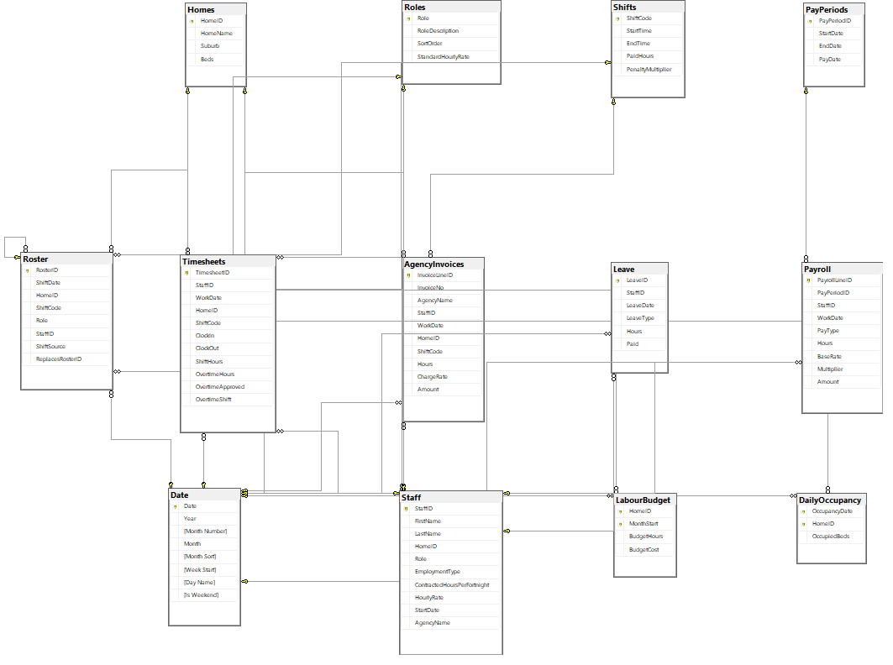
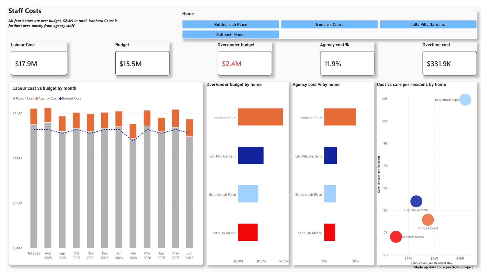
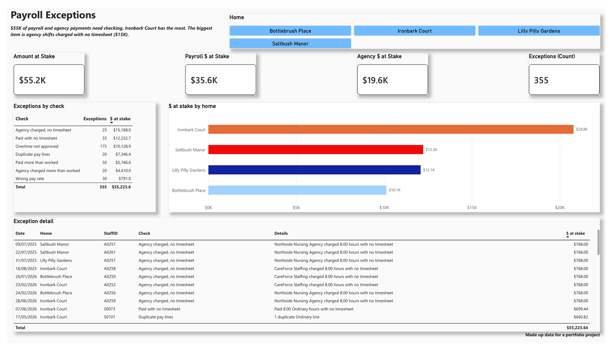
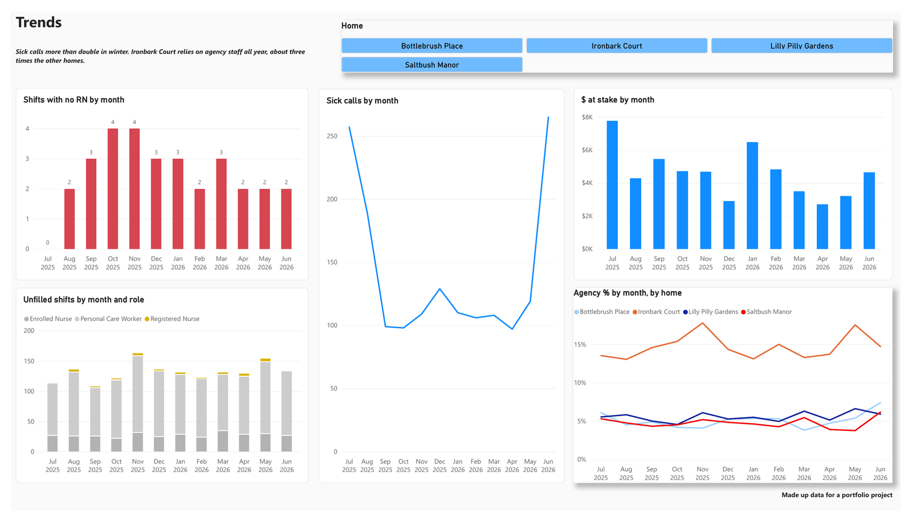

# Aged Care Workforce and Payroll Dashboard (SQL Server and Power BI)

A portfolio project for four aged care homes over one financial year (Jul 2025 to Jun 2026). It answers the questions an aged care manager asks every day: **Are we staffed safely today, what are we spending on staff, and are we paying for what was actually worked?**

The data is stored and checked in SQL Server and reported in Power BI.

> All data in this project is made up. The homes, staff, agencies and figures are not real.
>
> © 2026 Jehan Vijay. All rights reserved. You are welcome to view this work. Please do not copy, reuse or republish it without my permission.



## The report

| Page | Who it is for | What it shows |
|---|---|---|
| **Daily Huddle** | Facility manager, every morning | Shifts with no Registered Nurse, no shows, sick calls, open shifts for tomorrow, how today's gaps were covered, care minutes for the last 14 days |
| **Staff Costs** | Operations manager | Labour cost against budget, agency and overtime cost, cost against care by home |
| **Payroll Exceptions** | Payroll officer | Every payroll and agency mismatch, the dollars at stake, and a detail list to work through |
| **Trends** | Management | How RN gaps, unfilled shifts, sick calls, agency use and payroll problems change over the year |

## Key findings

* **All four homes are over budget, $2.4M in total.** Ironbark Court is furthest over (about $1M), mostly from agency staff.
* **Ironbark Court relies on agency staff all year.** About 20% of its labour cost is agency, around three times the other homes. It pays more per resident than Lilly Pilly Gardens but gives less care, because agency hours cost more.
* **Saltbush Manor has a care problem, not a cost problem.** It is the cheapest per resident and has the lowest care minutes (174 per resident per day, against a project target of 180).
* **Bottlebrush Place costs the most per resident but gives the most care (205 minutes).** It is the smallest home, and still needs a Registered Nurse on every shift.
* **About $55K of payroll and agency payments need checking.** The biggest item is agency shifts charged with no timesheet ($15K).
* **Sick calls more than double in winter** (June to August).
* On 30 June 2026, **Bottlebrush Place had no Registered Nurse rostered for the next night**, and half of the day's gaps were filled by agency staff.

## How it was built

### SQL Server

* Database `AgedCareWorkforce` on SQL Server 2025 Developer Edition.
* 12 source tables loaded from CSV with `BULK INSERT`, plus a Date table built in T-SQL.
* **Dimension tables:** Homes, Roles, Shifts, Staff, PayPeriods, Date.
* **Fact tables:** Roster, Timesheets, Leave, Payroll, AgencyInvoices, LabourBudget, DailyOccupancy.
* Primary keys on every table and foreign keys from every fact table.
* **11 reconciliation checks, each written as a SQL view.** They compare the roster, timesheets, leave, payroll and agency invoices:

| Area | Check | Found |
|---|---|---|
| Roster | Worked but not rostered | 40 |
| Roster | Rostered but no show | 60 |
| Roster | Unfilled shifts | 1,577 |
| Safety | Shifts with no Registered Nurse | 30 |
| Payroll | Paid more hours than worked | 50 |
| Payroll | Overtime paid but not approved | 175 |
| Payroll | Paid with no timesheet | 35 |
| Payroll | Wrong pay rate | 30 |
| Payroll | Duplicate pay lines | 20 |
| Agency | Agency charged more hours than worked | 20 |
| Agency | Agency charged with no timesheet | 25 |

* Each payroll and agency check also works out the **dollars at stake**.
* For wrong pay rates, overpayments and underpayments cancelled each other out ($74 net). I changed the check to add up the size of each mistake instead ($791), because both are problems.
* `vw_ExceptionDetail` stacks all 11 checks into one view with the same columns, so Power BI can filter and drill into them together.



### Power BI

* Connected to SQL Server in Import mode. All measures are in a `_Measures` table (see `dax/measures.dax`).
* **As at date:** the Daily Huddle works for one picked day, and looks one day ahead for open shifts.
* **Disconnected date table** (`Chart Dates`): lets the date slicer pick the "as at" day while the line chart still shows the 14 days before it.
* **USERELATIONSHIP:** Leave and Payroll only link to homes through Staff, so those measures turn on the inactive Staff to Homes relationship.
* **KEEPFILTERS:** used so a filter inside a measure adds to the chart's own filter instead of replacing it.
* **Drill down:** clicking a check on the Payroll Exceptions page filters the detail list to just those lines.
* Same colour for each home on every page, red and green rules against targets, and one home slicer synced across all pages.

## Report pages

| | |
|---|---|
|  |  |
|  | |

## Notes on the data

* The care minutes target of 180 is a project figure, set from the made up staffing levels.
* The labour budget is based on rostered hours at standard rates. It does not allow for agency premiums or penalty rates, which is one reason every home runs over.
* Payroll is paid up to 28 June 2026 (the last pay period). The last two days of June were worked but not yet paid, so June payroll looks a little low.

## Files in this repo

```
README.md
AgedCareWorkforce.pdf        PDF copy of the four report pages
DATA_DICTIONARY.md           What each table and column means
sql/
    01_create_tables.sql     Creates the database and tables
    02_load_data.sql         Loads the CSV files
    03_date_table.sql        Builds the Date table
    04_keys.sql              Primary and foreign keys
    05_exception_views.sql   The 11 checks and the summary view
    06_exception_detail.sql  All checks stacked in one view
dax/
    measures.dax             All DAX measures
images/
    daily-huddle.png
    staff-costs.png
    payroll-exceptions.png
    trends.png
    star-schema.png
```

## Report file and data

The Power BI report file (.pbix) and the CSV data are not included in this repo. I am happy to share them or walk through the report in an interview. Please contact me through GitHub or LinkedIn.

## What comes next

Version 2 adds an **AI agent** built in n8n. Each morning it reads the exception views, decides which problems matter most, looks for patterns the single line rules cannot see (for example, the same agency worker charged with no timesheet at two different homes), and writes a short briefing for each home manager. Its findings will be tested against the SQL rules on a new report page.

## Copyright

© 2026 Jehan Vijay. All rights reserved.

This repo is shared so people can see my work. No licence is given to copy, change, reuse or republish any part of it, including the SQL scripts, the DAX, the report design and the images.
